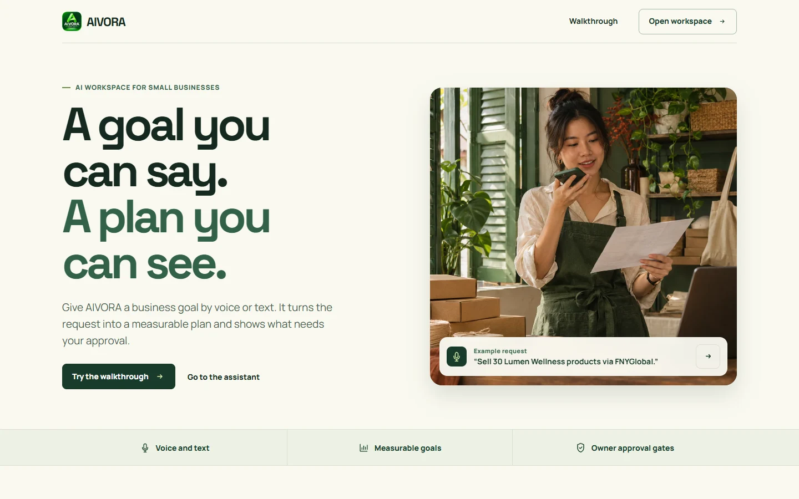

# AIVORA

**Turn a spoken or typed business goal into a plan the owner can review.**

A small-business owner can describe an outcome in a sentence, but turning it into tasks, drafts and approval decisions takes several tools. AIVORA gives that work a single starting point. It identifies a measurable goal, shows the workflow and surfaces which actions need the owner's decision.



## Try the hackathon walkthrough

1. Open the app at `/` and choose **Try the walkthrough**.
2. Start with the sample goal, “Sell 30 Lumen Wellness products via FNYGlobal.”
3. Choose **Show the plan** to inspect the steps, then **Review approval gates** to see the decisions for spending, publishing and customer messages.

The walkthrough runs in the browser with sample data captured from the local planning engine. It requires no sign-in, microphone, model key or external provider. Every action in the walkthrough is a preview.

## Run locally

Use Node.js 22 or newer. In PowerShell, run these commands from the repository root.

```powershell
npm ci
npm run build
$env:HOST = "127.0.0.1"
$env:PORT = "8081"
$env:AIVORA_MEMORY_MODE = "1"
npm start
```

Open [the overview](http://127.0.0.1:8081/) or go directly to [the workspace](http://127.0.0.1:8081/workspace).

- The **overview** explains the product and includes the self-contained walkthrough.
- The **workspace** contains the assistant and tools for appointments, document translation, procurement and other business workflows.
- Live model requests use Model Studio. To configure it, copy [the environment template](.env.example) to `.env.local` and add your credentials. Integration-specific features need their own configuration. Keep `.env.local` local.

## How it works

| Layer | What it does |
| --- | --- |
| [React workspace](src/App.tsx) | Accepts voice and text, shows action plans, and provides access to business tools. |
| [Objective engine](server/odai/objectives.mjs) | Extracts measurable criteria, projects task states, and tracks approval gates. |
| [Workflow engine](server/odai/workflow.mjs) | Records steps and receipts, with policy checks around dispatch. |
| [Walkthrough snapshot](src/hackathon-demo.json) | Replays a captured sample plan with no live writes. |

For a short judge presentation, show the request first, open the plan, then stop at approval. The walkthrough demonstrates the handoff from a free-form goal to a decision the owner can inspect. Some connectors run in sandbox mode or remain held pending configuration.

## Checks

```text
npm run typecheck
npm run build
node --test tests/overview_fixture.test.mjs
```

The walkthrough test replays the sample through the local engine and checks the displayed task and approval states against its output.

<details>
<summary>Hero artwork credit</summary>

The hero is an illustrative AI-generated photograph made with built-in ImageGen. It shows a fictional business owner. The optimized asset is [`public/aivora-small-business.webp`](public/aivora-small-business.webp).

> Use case: photorealistic-natural. Asset type: portrait-oriented hero photograph for AIVORA’s Singapore small-business workflow overview. Show a young adult Singaporean small-business proprietor at a quiet modern shophouse packing counter, speaking naturally into a smartphone held near her mouth while considering a paper order sheet. Waist-up candid editorial photography, subtle cardboard mailers, laptop turned away, warm late-morning sun through muted sage green shutters. Natural expression, realistic skin and hands, tactile wood and linen, rich deep forest greens, warm cream, tiny hints of rust, refined magazine color grading and soft film grain. Place subject in the middle-upper portion with foreground space along the lower edge for a separate HTML card. Portrait 4:5 framing with generous crop room, composition suits a split-screen hero beside large landing-page headline. No printed text, no readable screens, no logos, no watermarks, no overlaid UI, no Singapore skyline clichés.

</details>
